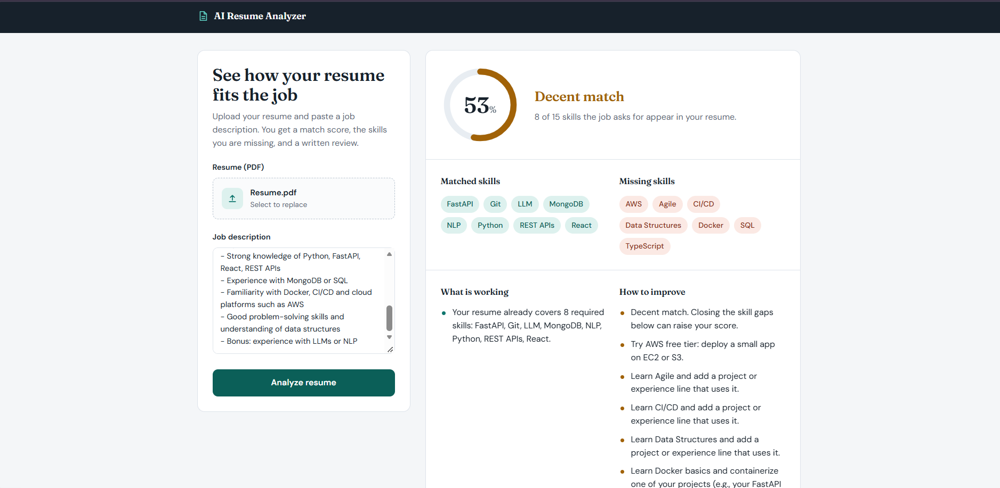

# AI Resume Analyzer & Job Matcher

Upload a resume PDF, paste a job description, and get an ATS-style match score, a skill-gap breakdown and an AI-written review.





## Features

- **Resume parsing:** extracts text from PDF resumes.
- **Skill extraction:** finds 60+ technical skills using alias-aware, whole-word matching (for example "ReactJS" and "React.js" both count as React).
- **ATS-style scoring:** the match score is the share of the job's required skills found in the resume.
- **Skill-gap analysis:** shows matched and missing skills as clear chips.
- **Improvement tips:** rule-based advice for each missing skill.
- **AI review:** a Gemini-generated summary, resume improvements and next steps, specific to your resume and the job.
- **Graceful fallback:** if the AI service is busy or fails, the score and skill results still load.
- **Responsive UI:** drag-and-drop upload, animated score ring, keyboard-accessible.

## Tech stack

| Layer | Technology |
|---|---|
| Frontend | React, Vite, CSS |
| Backend | Python, FastAPI, Uvicorn |
| PDF parsing | pypdf |
| LLM | Google Gemini API (`google-genai`) |
| Config | python-dotenv |

## How it works

1. The backend extracts text from the uploaded PDF.
2. Skills are detected in both the resume and the job description.
3. Score = matched skills / required skills x 100.
4. Recommendations are generated from the missing skills.
5. The resume and job description are sent to Gemini for a written review. If the call fails or times out (30 s), the response is returned without it.

## Getting started

**Prerequisites:** Python 3.10+, Node.js 18+, and a free Gemini API key from [Google AI Studio](https://aistudio.google.com).

### Backend

```bash
cd backend
python -m venv venv
venv\Scripts\activate        # macOS/Linux: source venv/bin/activate
pip install -r requirements.txt
copy .env.example .env       # macOS/Linux: cp .env.example .env
```

Open `.env` and add your API key, then start the server:

```bash
uvicorn main:app --reload
```

The API runs at `http://127.0.0.1:8000` (interactive docs at `/docs`).

### Frontend

```bash
cd frontend
npm install
npm run dev
```

Open `http://localhost:5173`.

## API

| Method | Endpoint | Description |
|---|---|---|
| GET | `/` | Health check |
| POST | `/upload-resume` | Upload a PDF, returns extracted text and skills |
| POST | `/analyze` | Form data: `file` (PDF) and `job_description` (text). Returns score, matched and missing skills, tips and AI review |

## Project structure

```
ai-resume-analyzer/
├── backend/
│   ├── main.py              # FastAPI app and routes
│   ├── skills.py            # Skill database and extraction
│   ├── scoring.py           # Matched/missing skills and score
│   ├── recommendations.py   # Rule-based improvement tips
│   ├── llm.py               # Gemini integration with fallback
│   ├── requirements.txt
│   └── .env.example
├── frontend/
│   └── src/                 # React UI (App.jsx, App.css, index.css)
└── docs/
    └── screenshot.png
```

## Limitations and roadmap

- The skill list is fixed, so skills outside it are ignored.
- Scanned (image-only) PDFs are not supported, because there is no OCR.
- The score measures skill overlap only. It is not a real ATS.
- Planned: semantic matching with embeddings, resume section parsing (education, experience), and deployment.

## Author

Built by Aditya Gunjal.